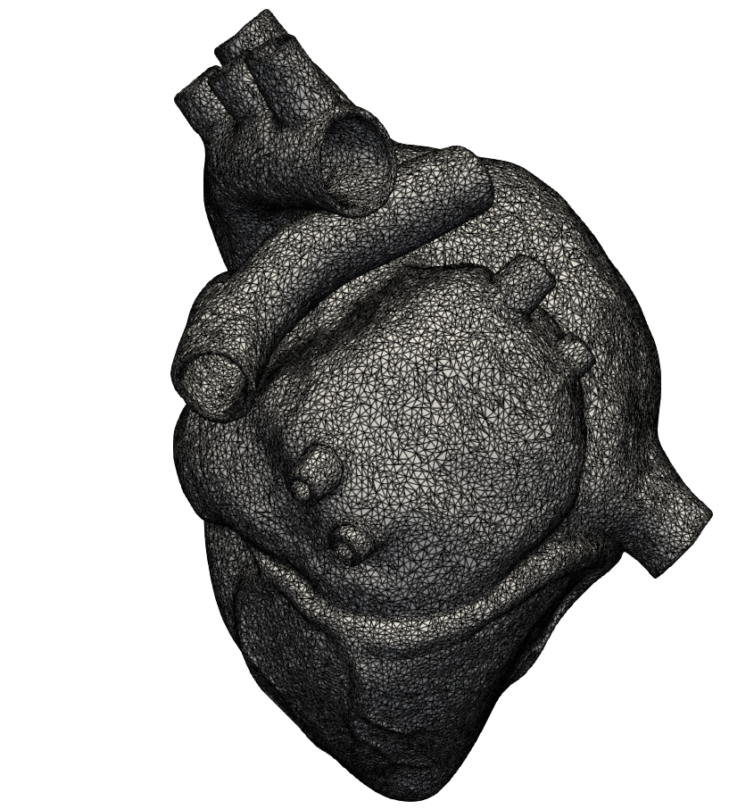

[](https://github.com/itchinda/cfempp/actions/workflows/ci.yml)

# CFEM++: High-Performance Finite Element Solver

**CFEM++** is a research-grade C++ library designed for large-scale computational mechanics. It bridges the gap between complex geometric preprocessing in **Gmsh** and high-performance linear algebra via the **PETSc** framework.

Designed to handle **10^7+ Degrees of Freedom (DoFs)**, the project focuses on topological robustness, memory-efficient assembly, and high-order element support.

---

## 🚀 Key Features

### 1. Robust Mesh Topology
* **Gmsh 4.1 Integration:** Native support for MSH ASCII formats with advanced vertex unique-ification and tag interning.
* **Dual-Layer Entity System:**
    * **Universe (ID -1):** Mandatory computational domain definition.
    * **SYS_BOUNDARY (ID -2):** Automated exterior facet detection to ensure 100% Boundary Condition (BC) coverage.
* **Corner-Based Mapping:** A specialized algorithm for quadratic elements (TET10, HEX27) that identifies physical entities by intersecting geometric vertices (corners), effectively solving the "mismatched diagonal" problem in high-order meshes.


### 2. High-Performance Computing (HPC)
Leveraging **PETSc** for its linear algebra core, CFEM++ provides:
* **Distributed Computing:** MPI-parallelized operations using `Vec` and `Mat` (AIJ format).
* **Advanced Solvers:** Optimized for **Preconditioned Conjugate Gradient (PCG)** with **Algebraic Multigrid (GAMG)** preconditioning.
* **Scalability:** Capable of processing ~8M nodes and ~6M cells in under 30 seconds on standard workstation hardware (32GB RAM).


### 3. Comprehensive Element Library
| Dimension | Linear Elements | Quadratic Elements |
| :--- | :--- | :--- |
| **1D** | LINE2 | LINE3 |
| **2D** | TRI3, QUAD4 | TRI6, QUAD9 |
| **3D** | TET4, PRISM6, HEX8 | TET10, PRISM18, HEX27 |

---

## 🛠 Installation & Dependencies

Ensure you have the following installed:
* **C++17 Compiler** (GCC, Clang, or MSVC)
* **CMake** (3.15+)
* **PETSc** (configured with MPI and HYPRE/MUMPS recommended)
* **Gmsh** (for mesh generation)

```bash
git clone [https://github.com/username/cfempp.git](https://github.com/username/cfempp.git)
cd cfempp
mkdir build && cd build
cmake ..
make -j
```

```c++
#include "Mesh.h"
#include "GmshParser.h"
#include "VTKExporter.h"

int main() {
    // Creates a [-1, 1] x [-1, 1] square mesh with 40,000 quadratic elements.
    auto mesh = QuadMeshBuilder::create(
        MeshOrder::Quadratic,
        QuadMeshBuilder::Subdivisions{100, 100},
        QuadMeshBuilder::Corners{
                Vector3D{-1., -1., 0.}, // Bottom-Left
                Vector3D{ 1., -1., 0.}, // Bottom-Right
                Vector3D{ 1.,  1., 0.}, // Top-Right
                Vector3D{-1.,  1., 0.}  // Top-Left
        },
        QuadMeshBuilder::ElementType::CrissCross
    );

    std::cout << mesh->info() << std::endl;

    // Define the polynomial basis on the mesh.
    auto p1Space = LagrangeSpace::create(mesh, Order::P1, FieldType::Scalar);   // Pressure (Linear)
    auto p2Space = LagrangeSpace::create(mesh, Order::P2, FieldType::Vector3D); // Velocity (Quadratic)

    // Associate physical fields with their respective function spaces.
    auto pressure = FEField::create("P", p1Space);
    auto velocity = FEField::create("U", p2Space);

    // Define exact solutions and project them onto the FE basis.
    const CfemReal PI = cfem::pi;
    auto analytical_p = [&](const Vector3D &X) -> CfemReal {
        return X.x * X.x + X.y * X.y + X.x*X.y + X.x + X.y + 1;
    };
    auto analytical_u = [&](const Vector3D &X) -> Vector3D {
        return {
            std::sin(2 * PI * X.x) * std::sin(2 * PI * X.x), 
            std::cos(2 * PI * X.y) * std::cos(2 * PI * X.y), 
            0.0
        };
    };
    
    // Projection step
    pressure->project(analytical_p);
    velocity->project(analytical_u);

    // L2 Errors
    #include "Quadrature.h"
    IntegrationSchemeParams schemes_params{};
    schemes_params.NumIntgPtTriElem = 12;
    CfemReal lNorm_l2_p {FEField::L2NormDistance(*pressure, analytical_p, schemes_params)};
    CfemReal lNorm_l2_u {FEField::L2NormDistance(*velocity, analytical_u, schemes_params)};
    std::cout << "L2 Error norm for P: "  << lNorm_l2_p << std::endl;
    std::cout << "L2 Error norm for U: "  << lNorm_l2_u << std::endl;

    // Prepare the VTK exporter and add fields for visualization.
    VTKExporter vtk_exporter(*mesh);
    // Define which boundary entities to include in the output
    vtk_exporter.setExportedEntities({"Bottom", "Top", "Right", "Left", "SYS_BOUNDARY"});

    // Add Field to be exported
    vtk_exporter.addField(*pressure);
    vtk_exporter.addField(*velocity);

    //Export execution!
    vtk_exporter.write("square.vtk");
    
    return 0;
}

```
**From Preprocessing to Visualization**: Our robust `GmshParser` handles non-trivial manifolds with ease. Shown below is a 3D heart model imported into CFEM++ and visualized in ParaView. The seamless integration ensures that physical tags and boundary conditions remain consistent from the initial `.msh` file to the final visual results.

<p align="center">
  
  <br>
  <i>Figure 1: Complex cardiac geometry imported from Gmsh and visualized in ParaView.</i>
</p>

## 📊 Performance Benchmark

- **Hardware**: Intel Core Ultra 7 (165U), 32GB RAM.
- **Workload**: 7.9M nodes, 5.8M cells (3D Quadratic).
- **Load Time**: ~29 seconds (ASCII Parsing + Topological Reconstruction).

## 📝 Metadata & License
- **Lead Developer**: itchinda
- **Version**: 0.1.0 (High-Order HPC Release)
- **Status**: Active Research
- **License**: Copyright (c) 2026 CFEM++ Team. All rights reserved.
